# 加热炉文丘里压力 · 快捷读数

按现场实际流程做的前端：**逐台录完 2#～5# 炉的文丘里读数 → 回主界面 → 去操作室看集合管压力 → 点「绝压比计算」填压力，生成方式2**。

**在线使用（手机推荐，HTTPS，可开相机）：** <https://hanhaicangnan99.github.io/heater-venturi-reader/>

> 如果手机/电脑还显示旧界面，打开 <https://hanhaicangnan99.github.io/heater-venturi-reader/?v=2.22.0> 一次；页脚会显示当前版本 `v2.22.0`。

**代码仓库：** <https://github.com/hanhaicangnan99/heater-venturi-reader>

**第二阶段交接报告：** [交接报告_第二阶段.md](交接报告_第二阶段.md)

- 2号炉：8 组 × **2 块**（每行一组）
- 3/4/5号炉：8 组 × **12 块**（每行 6 块、两行一组）
- 第 1～4 组 = **A 炉膛**，第 5～8 组 = **B 炉膛**；可只测半台
- 单炉页主区域是**相机实时预览**，中间最大按钮是「开始识别 / 暂停识别」
- 支持**送检跳过、整台炉反向、暂停后从指定表继续**
- 支持**手动快捷输入**：粘贴方式1文本，只调每组最高表的位号和读数
- 录入页只录文丘里读数，不填集合管压力、不算绝压比
- 导出「文丘里压力」纯文本，或「导出所有数据」带格式的 Excel
- 「导入 Excel」可把导出的 `.xlsx` 读回来
- 线上 HTTPS 地址手机可直接用相机；直接打开本地文件时相机被浏览器限制，录入/导出仍可用

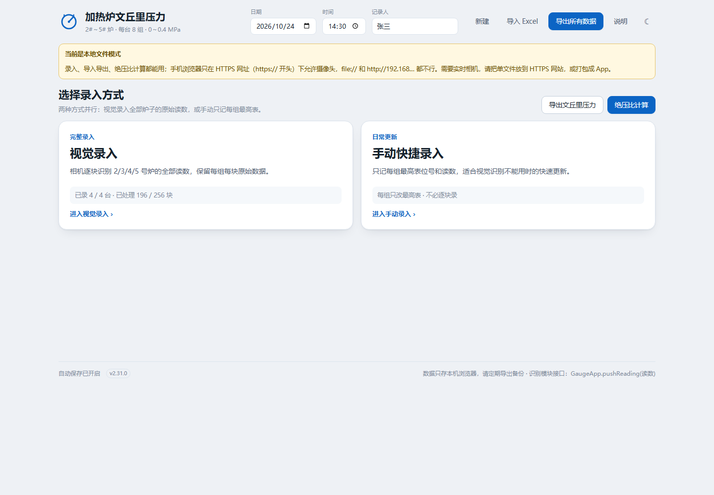

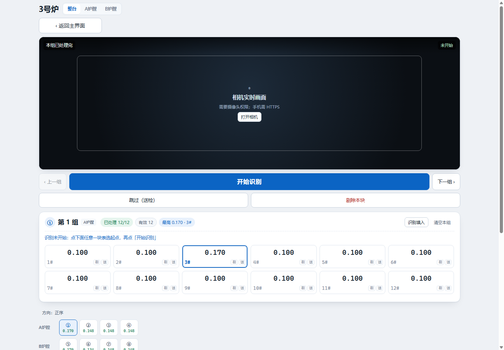

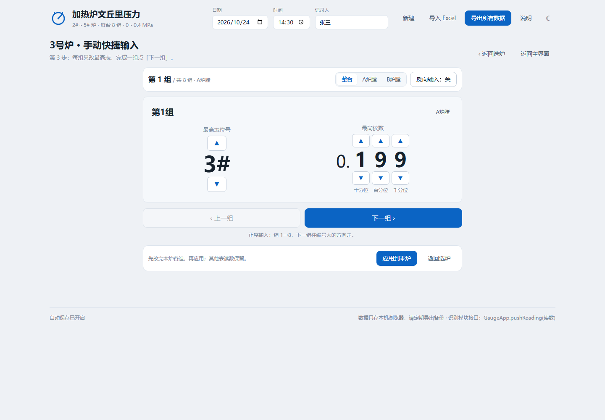

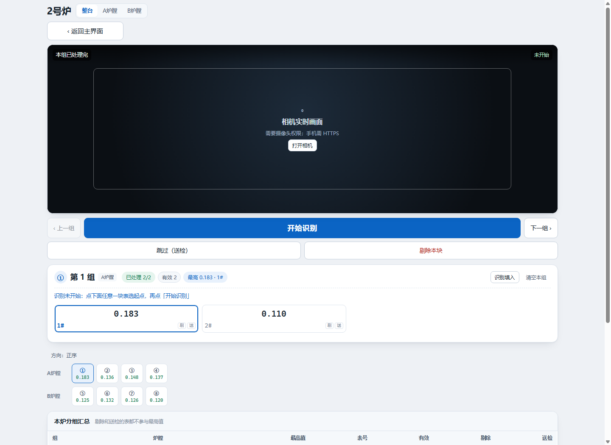

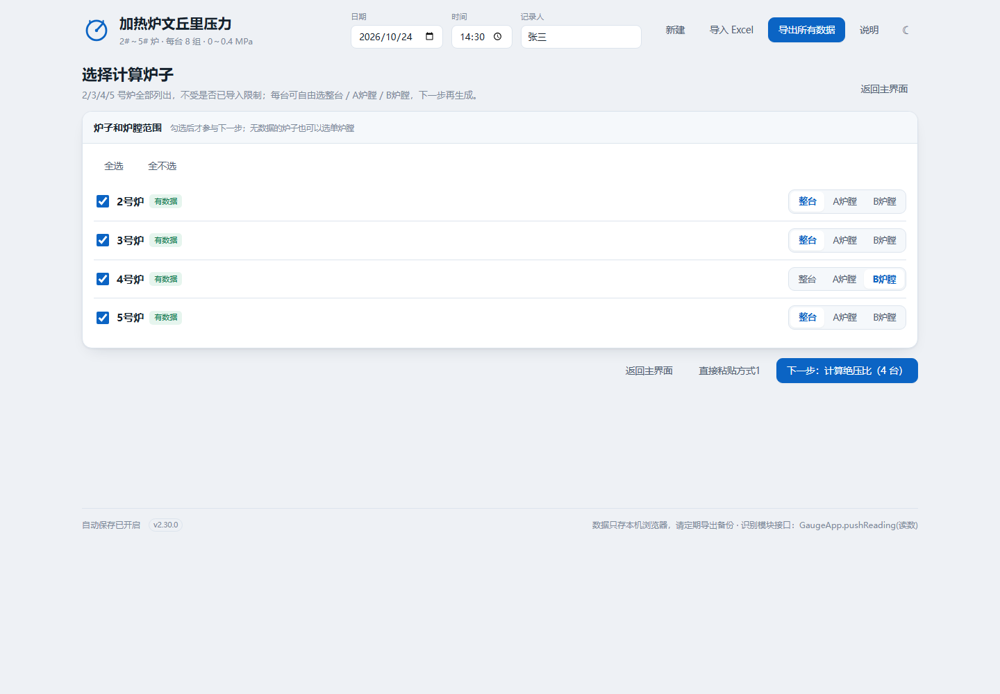

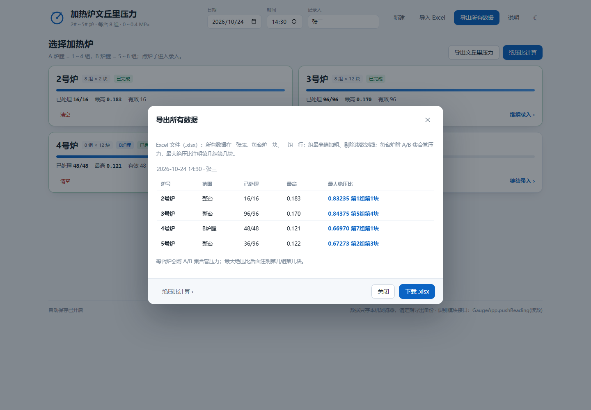

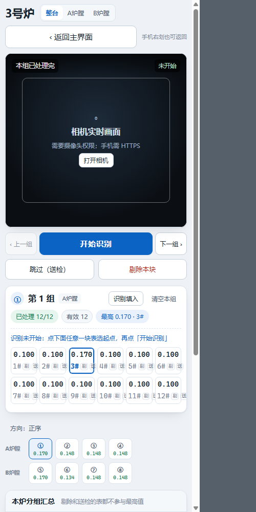

---

## 一、正常流程

1. **填日期/时间**：顶部（首页/绝压比页）填日期、时间、记录人。
2. **录读数**：首页选炉子 → 大按钮「开始识别」→ 逐组录入 → 「下一组」→「完成本炉」回主界面。
   - 2#～5# 炉都录完（或只录这次要测的炉子）。
   - 单炉页隐藏全局顶栏，只显示炉号/炉膛和返回。
3. **看压力**：到操作室看 A/B 集合管压力，记下来。
4. **算绝压比**：回主界面点「**绝压比计算**」。
   - 打开时自动载入当前所有读数并解析好；
   - 在每台炉卡片上填 A/B 集合管压力；
   - 下方实时生成方式2，复制或下载 `.txt`。
5. **导出**：
   - 顶栏「**导出所有数据**」：Excel，一张表，含日期时间、逐块读数、组最高值、A/B 集合管压力、绝压比；
   - 首页「**导出文丘里压力**」：方式1纯文本。

> 如果手上是别人发来的方式1文本或老记录：在「绝压比计算」页把文本整段替换掉，点「解析文本」即可，不影响当前录入的数据。

---

## 二、页面

### 首页

- 四台炉卡片：2号炉（8×2）、3/4/5号炉（8×12）；显示已处理/总数、最高值、有效/剔除/送检、是否完成。
- 每台炉卡片左下角有「**清空**」，只清空这一台炉。
- 按钮：「导出文丘里压力」「绝压比计算」；顶栏另有「导出所有数据」「导入 Excel」。
- 本地文件打开时，首页会显示黄色「当前是本地文件模式」提示。

### 单炉页

- **极简顶部**：隐藏全局顶栏；第一行只显示「几号炉 + 整台/A炉膛/B炉膛」，第二行是加宽的「‹ 返回主界面」按钮。
- **手机右划返回**：从页面中间向右划（避开输入框、按钮、表格、弹窗）可回主界面。
- **相机预览（主区域）**：进入炉子页自动尝试打开摄像头，表盘对准取景框；无权限时显示占位和「打开相机」。
- **大按钮**：上一组和下一组中间是「开始识别 / 暂停识别」，按当前状态切换。
- **下一行**：「跳过（送检）」「剔除本块」。
- **方向**：底部、组快捷跳转上方；整台炉正序/倒序。
- **起点**：点组内任意一块表，该格橙色高亮；再点「开始识别」，就从这块开始（已有旧读数会被覆盖）。
- **当前组**：圈号 + 第 N 组 + 炉膛标签 + 已处理/有效/剔除/送检/最高值；「识别填入」「清空本组」。
- **读数格**：每行 6 个，12 块两行；2号炉每组 2 块、一行一组；最高读数格蓝色描边；剔除后划线；送检显示「送检」；超量程变红。
- **待录入提示**：显示下一个待识别位置。
- **底部**：A/B 组快捷跳转 → 本炉分组汇总（最高值、表号、有效、剔除、送检）。
- 没有集合管压力输入，没有绝压比。
- 导出/清空回首页卡片上操作。

### 绝压比计算页

- 顶部「方式1 文本」：打开时自动填入当前读数并解析；可粘贴老记录覆盖后点「解析文本」；「载入当前读数」可恢复。
- 炉膛标题支持 `4号炉A`、`4号炉 A`、`4号炉A炉膛`、`4号炉B侧` 等简写。
- 解析结果：每台炉一张卡片，显示整台/半台、各组最高值+表号、A/B 集合管压力输入、该炉两个炉膛的绝压比。
- 方式2 预览：实时更新，可复制/下载。
- 当前读数模式下填的集合管压力会**自动保存在本机**，供「导出所有数据」使用；粘贴老记录时只临时计算，不写入当前数据。

### 规则

- 2号炉每组 2 块；3/4/5号炉每组 12 块。
- A 炉膛 = 第 1～4 组；B 炉膛 = 第 5～8 组。
- 只测半台时，在单炉页第一行切「A炉膛 / B炉膛」，组页签自动变 4 个；另一半数据保留但不参与统计/导出。
- 剔除、送检都不参与最高值和绝压比。

---

## 三、两种导出

### 手动快捷输入（日常更新）

一般情况下，每组文丘里的最高一直是固定的一支压力表，只是数值变。日常更新用这个模式，分成 3 页；它也是**视觉识别不能用时的备用人工方式**：

1. **导入页**：首页点「**手动快捷输入**」，粘贴「导出文丘里压力」的方式1文本，或点「载入当前数据」；也可以点「**不导入，直接手动**」。
2. 点「**解析文本**」→ 自动进入 **选炉页**。
3. **选炉页**：**始终显示全部 2/3/4/5 号炉**。
   - 有导入数据的炉子正常显示「已导入」；
   - 没导入的炉子虚线显示「未导入 · 手动」，同样可以点进去补；
   - **未导入炉子的默认值**：每组默认 **1#**，第一组读数 **0.000**，后面各组默认跟随第一组的数据；某组手动改过之后，该组不再跟随；
   - 点需要增补的炉号，进入该炉的 **单炉逐组页**。
4. **单炉逐组页**：
   - 一次只显示一组，位号和读数都放大；
   - **最高表位号**：一组上下箭头，改 1#～12#（2号炉 1#～2#）；
   - **最高读数**：十分位/百分位/千分位三列，每列上下箭头，支持进位/借位（0.199 + 千分位 = 0.200）；到边界后循环（0.000 千分位↓→0.009、百分位↓→0.090、十分位↓→0.400；0.400↑→0.000）；
   - 位号到 1# 按↓回最大（2号炉 2#，其余炉 12#）；
   - 每台炉顶部始终有 **整台 / A炉膛 / B炉膛** 三个选项；4 行文本没写炉膛时默认 A，可自己切 B；
   - **导入半台后切整台**：空白半台默认跟随第一组；跟过的组会写回，没跟过也没改过的占位组不写，导入的那半保留；
   - 「**反向输入：开/关**」：打开后按 组8→1 切换，「下一组」往编号小的方向走；
   - 完成一组点「**下一组**」；到最后一组按钮变「**完成本炉**」，回选炉页。
5. 在单炉页点「**应用到本炉**」，或在选炉页点「**全部应用到当前数据**」。

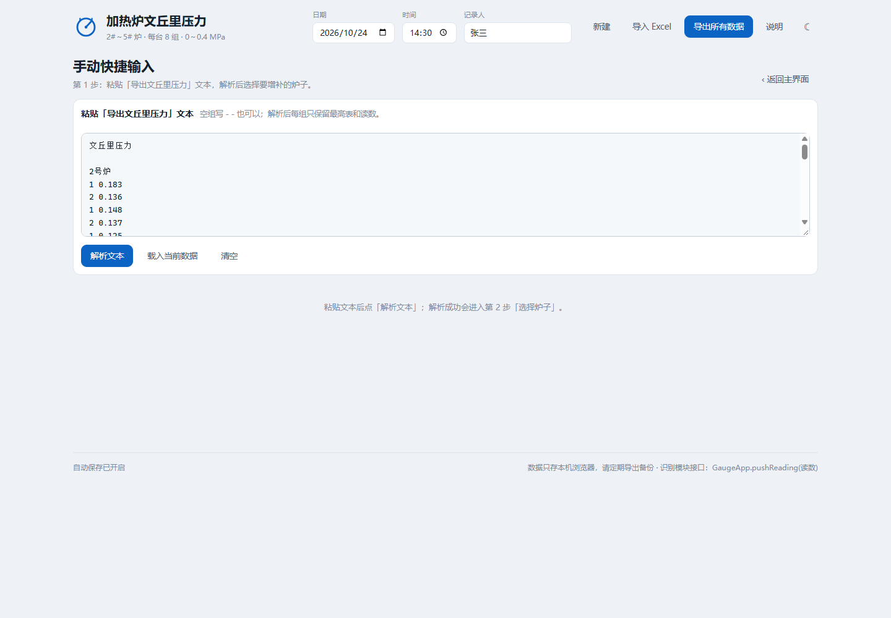

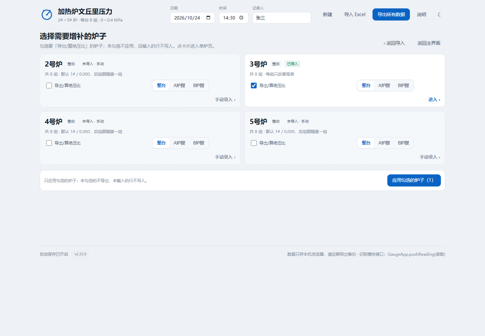


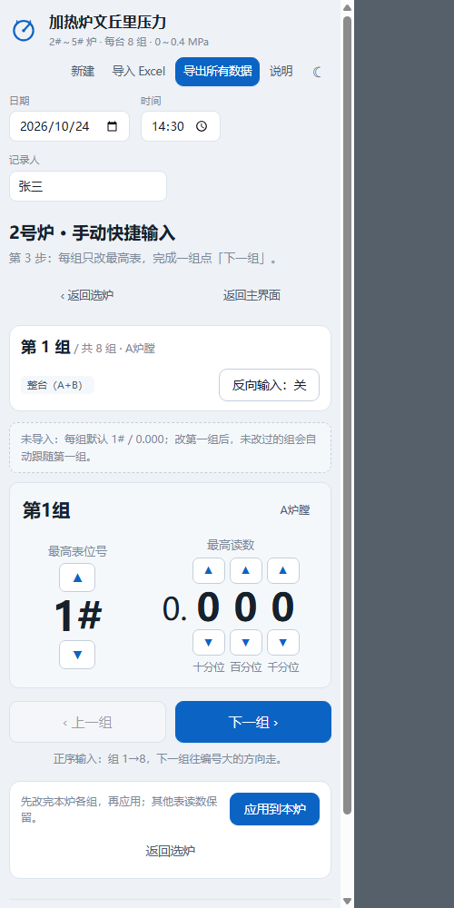

应用规则：

- 只更新每组选中的最高表，**其他表读数保留**，不破坏之前完整录入的数据。
- 如果最高表换位，旧最高表的值会被清掉，避免旧值继续压住新值。
- 如果本组其他表还有更高读数，会提示「其他表读数更高」，需要到完整录入页检查。
- 空组（方式1里的 `- -`）不应用；用箭头调过之后才会写入。
- 应用后可在首页看统计，或继续导出 Excel/方式1。

### 导出文丘里压力（方式1，纯文本）

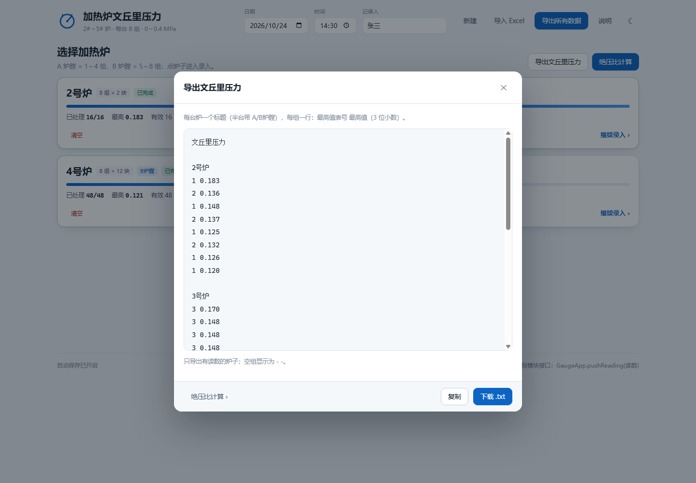

只导出**有读数且在当前炉膛范围内**的炉子；按 2# → 3# → 4# → 5# 顺序。半台标题带 `A炉膛 / B炉膛`。

```
文丘里压力

2号炉
1 0.183
2 0.136
...
```

- 每组一行：`最高值表号 最高值`（3 位小数）。
- 没有读数的组输出 `- -`，保持组的位置。
- 「复制」进剪贴板，「下载 .txt」带 UTF-8 BOM，记事本打开不乱码。
- 示例：[示例/文丘里压力_方式1_示例.txt](示例/文丘里压力_方式1_示例.txt)

### 导出所有数据（Excel）


顶栏「**导出所有数据**」，文件名形如 `加热炉文丘里压力_20261024_1430.xlsx`，Excel / WPS 直接打开。

所有数据在**同一张「读数」表**：

- **每台炉一块**：炉号只在块标题出现一次，不再每行重复「2号炉,A炉膛」。
- 表头：组 / 1#～12# / 最高值 / 表号；**一组一行**。
- **组最高值加粗**：该组最高的读数格和「最高值」列都加粗。
- **剔除读数加删除线**：原值保留，能看出被剔除。
- **送检表写「送检」**：不参与最高值/绝压比，和漏录区分开。
- 每块末尾补充 A/B 集合管压力：

```
A集合管压力  0.230   B集合管压力  0.220
最大绝压比   0.84375  第5组第4块
```

- 半台炉只显示对应炉膛的集合管压力。
- 最大绝压比只加粗，不放大字号。
- 最大绝压比后面注明「第几组第几块」，例如 `第5组第4块`（表号 4#）。
- 不再输出「全厂最高绝压比」行。
- 绝压比来自「绝压比计算」里填的集合管压力（会自动保存在本机）；没填的炉膛显示为空。
- 只包含有读数的炉子。
- 示例：[示例/导出所有数据_示例.xlsx](示例/导出所有数据_示例.xlsx)

### 导入 Excel

顶栏「**导入 Excel**」选一个由本软件导出的 `.xlsx`，会把整份任务读回来：

- 日期、时间、记录人；
- 每台炉/半台范围、每组每块读数；
- 剔除标记（按删除线样式识别）；
- 送检标记（按「送检」文字识别）；
- A/B 集合管压力。

导入会覆盖当前数据（当前有数据会先确认），然后回主界面。最大绝压比不直接存进 Excel，导入后按读数和集合管压力重新计算。

也兼容旧版「读数 + 绝压比」两张表的 Excel，以及旧 JSON 备份。剔除依赖删除线，送检依赖「送检」文字；如果 Excel 里把删除线清掉了，导入后该读数会按有效处理。

---

## 四、绝压比计算（生成方式2）

### 公式

```
A绝压比 = (A 炉膛最高读数 + 0.1) / (A 集合管压力 + 0.1)
B绝压比 = (B 炉膛最高读数 + 0.1) / (B 集合管压力 + 0.1)
最大绝压比 = max(A绝压比, B绝压比)
```

- 「单炉膛最高」= 该炉膛 4 个组里所有有效读数（未剔除、未送检）的最大值。
- 用 `导出文件示例/快捷导出方式2.txt` 验算：3号炉 B 炉膛最高 0.170、B 集合管 0.220 → `(0.170+0.1)/(0.220+0.1)=0.84375`，与示例一致，标注组号 ⑤。
- 两个炉膛取较大者，并标出最高读数所在组。

### 方式2 格式

```
3号炉
①<3>0.170 ②<3>0.148 ③<3>0.148 ④<3>0.148 A集合管 0.230
⑤<4>0.170 ⑥<3>0.134 ⑦<3>0.148 ⑧<3>0.148 B集合管 0.220
最大绝压比 ⑤ 0.84375
```

- `①～⑧` 组号，`<3>` 该组最高读数所在表号，后接读数。
- 行尾 `A/B集合管` 是该炉膛集合管压力。
- 没填集合管压力时显示 `—`；空组显示 `<->-`。
- 示例：[示例/文丘里压力_方式2_示例.txt](示例/文丘里压力_方式2_示例.txt)

### 粘贴方式1

- 支持多台炉、半台炉、全角空格、BOM、`- -`、`3#`/`第3块`/`0.170 MPa` 等写法。
- 炉膛标题很宽松：`4号炉A`、`4号炉 A`、`4号炉Ａ`、`4号炉A炉膛`、`4号炉B侧`、`4号炉B炉膛` 都能识别。
- 表号和读数之间可以没有空格：`1#0.183`、`第2块0.136`。
- 整台 8 行、半台 4 行；4 行但标题没写炉膛时默认按 A，可在卡片上点「A炉膛 / B炉膛」切换。
- 标题写了 A/B 但给了 8 行时，自动按整台处理并提示。

---

## 五、识别模块接入

页面已暴露接口，摄像头/录屏识别程序只要在页面里调用即可：

```js
GaugeApp.openFurnace('3');     // 打开 3 号炉

GaugeApp.pushReading(0.170);   // 识别到一个读数 → 填入当前识别位置
// 返回 { furnace: '3', group: 0, index: 2 }
```

- `pushReading(value)`：填入当前识别位置；组满自动进入下一组（按当前方向），暂停时返回 `null`。
- `pushReadings([0.170, 0.148, ...], { advance: true })`：批量顺序填入。
- `GaugeApp.getTarget()`：`{ furnace, group, index, reverse, paused }`，用于引导摄像头对准。
- `GaugeApp.skipCurrent()` / `skipGauge(group, index)`：把当前/指定表标记为送检并跳过。
- `GaugeApp.setDirection(true)`：整台炉反向（组8→1、组内12#→1#）。
- `GaugeApp.pauseRecognition()` / `resumeRecognition(index)`：暂停识别；从当前组第 `index` 块（0 基）继续。
- `GaugeApp.isPaused()`：识别是否暂停（进炉子页默认暂停，点大按钮「开始识别」后才接收）。
- `GaugeApp.getVideo()` / `getStream()`：相机 `<video>` 和 `MediaStream`，识别模块可直接取帧。
- `GaugeApp.startCamera()` / `stopCamera()`：手动开关相机。
- `GaugeApp.getBatch()`：当前全部数据。

### 三种现场特殊情况

1. **表被送检**：点「跳过（送检）」或格子右下「送」，该表标为送检。
   - 不参与最高值、绝压比和有效数；
   - 进度按「已处理」算，送检也算处理完；
   - 导出 Excel 里写「送检」，导入时按「送检」恢复；
   - 点「送」可取消。
2. **反向读取**：点底部的「方向：正序/倒序」，整台炉按 组8→1、组内 12#→1# 识别；「下一组」也按该方向。
3. **现场排表/换表**：点「暂停识别」，换好表后点下面那一块表，再点「开始识别」，就从这块开始。
   - 点格子会把该块设为起点（橙色框），再点大按钮开始；
   - 要换组，先点 A/B 组快捷跳转或上一组/下一组，再点目标表；
   - 识别中点击某格会自动暂停，等待你点「开始识别」。

「识别填入」弹窗是同一接口的可视化入口，粘贴多行读数即可验证顺序填入。

> 摄像头实时识别属于下一阶段：本页面负责“识别结果落地 + 人工复核 + 统计导出”。

---

## 六、手机怎么打开

**直接用线上地址（推荐）：** <https://hanhaicangnan99.github.io/heater-venturi-reader/>

手机 Chrome / Safari 打开即可，HTTPS 安全上下文，能正常申请摄像头。代码推送到 GitHub 后，Pages 会自动更新。

### 安装到手机桌面（PWA）

线上地址已经是可安装的 PWA：

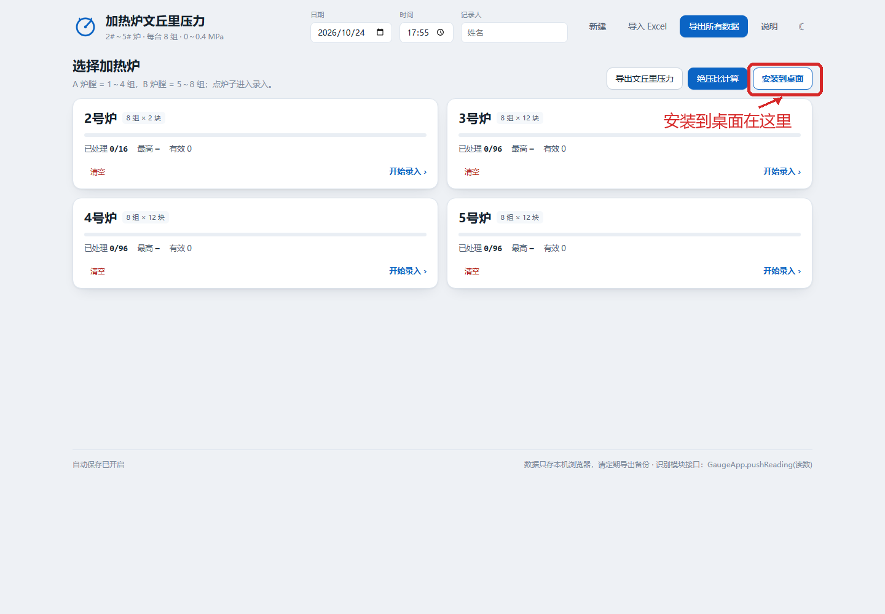

- **Android Chrome**：打开线上地址 → 首页点「安装到桌面」，或右上角 ⋮ → 安装应用 / 添加到主屏幕。
- **iPhone / iPad**：用 Safari 打开 → 点底部分享按钮 → 添加到主屏幕。
- 装好后桌面出现「**读表**」图标，全屏打开，没有地址栏，像 App 一样。
- 页面已注册 Service Worker，会缓存界面文件；断网时仍能打开已缓存页面。
- 只有 `https://` 线上地址能安装；`file://` 本地文件和单文件版不能安装。
- 如果首页没看到「安装到桌面」，先刷新一次，或直接用浏览器菜单安装。

如果不用线上地址、直接打开本地文件，常见两个问题：

1. **只传了 index.html**：页面缺 `js/`、`assets/`，会空白或没样式。用 [读表软件_手机版.html](读表软件_手机版.html)，CSS/JS 已内联，只传一个文件即可。
2. **`file://` 不能调摄像头**：手机浏览器本地 HTML 不允许 `getUserMedia`。录入、导入导出、绝压比计算仍可用；实时相机需要 HTTPS。

其他做法：

- **只录入/导出**：把 `读表软件_手机版.html` 发到手机，用 Chrome（Android）或 Safari（iOS）打开。
- **自己部署 HTTPS**：把单文件放到 GitHub Pages / Netlify / Vercel / 公司 HTTPS 服务器；`file://` 和 `http://192.168…` 都不允许摄像头。
- 不要在微信/QQ 的文件预览里打开，脚本常被限制；用系统浏览器。
- 本地文件模式下 `localStorage` 可能受限，重要数据及时「导出所有数据」Excel 备份。

页面在 `file://` 下会在首页显示黄色提示，说明当前是本地文件模式。

### 生成单文件版

改完 `index.html` / CSS / JS 后运行：

```bash
node tests/make_singlefile.cjs
```

会重新生成 `读表软件_手机版.html`。

---

## 七、阶段二 / 三的建议

### 阶段二：录屏识别演示

参考成熟项目，不从头搭：

| 项目 | 可复用点 |
| --- | --- |
| [Jason-Shell/gauge-ai-reader](https://github.com/Jason-Shell/gauge-ai-reader) | YOLOv8-Pose 关键点 + 角度双量程 + ONNX/TFLite |
| [zhahoi/Nanodet-YoloV8-Pose-MeterReader](https://github.com/zhahoi/Nanodet-YoloV8-Pose-MeterReader) | 轻量检测 + Pose |
| [VisionMillionDataStudio/Analog-Dials-Details385](https://github.com/VisionMillionDataStudio/Analog-Dials-Details385) | 数据集与训练脚本 |
| [6Superman6/yibiao_rec](https://github.com/6Superman6/yibiao_rec) | 模板匹配 + OCR 工程化参考 |

关键点：表盘中心 `O`、零点 `S`、满度点 `E`、指针尖 `P`：

```
t = (∠P − ∠S) / (∠E − ∠S)
值 = min + t × (max − min)
```

照片里表盘玻璃错位（`0.2` 看起来像 `0`），数字 OCR 易误判，但刻线端点与指针的几何关系仍成立，走关键点 + 角度更稳。

建议流水线：

```
录屏 → 抽帧 → 表盘检测 → 关键点 → 角度读数 → 多帧中位数/投票
     → JSON → GaugeApp.pushReadings(...) → 人工复核/剔除 → 导出文丘里压力（方式1）
```

验收建议：与人工读数比，MAE ≤ 0.005 MPa、95% 误差 ≤ 0.01 MPa。

### 阶段三：手机 App

- **Capacitor**（推荐）直接包现有页面，复用全部界面与接口。
- 相机页：取景框引导 → 端侧模型（ONNX Runtime Mobile / TFLite / NCNN）→ 识别一个就 `pushReading` → 确认 → 下一块。
- 一块表确认后自动移动到下一格；一组完成提示「下一组」；半台炉只走 4 组。
- 离线优先，数据仍存本机。

---

## 八、还需要你收集的现场资料

建议先做 **3号炉（8×12，96 块）** 一整台，跑通再铺开：

| 资料 | 数量/要求 | 用途 |
| --- | --- | --- |
| 每块表正面清晰照 | 96 张/台，表盘占画面 ≥ 60%，正对、避反光；另拍 2～3 个角度 | 检测、关键点标注 |
| 每块表短视频 | 每块 3～5 秒，含指针 | 录屏识别演示 |
| 整台巡检录屏 | 组1→组8、A→B 顺序，每块停 ≥ 2 秒；白天/手电各一遍 | 阶段二主输入 |
| 人工真值读数 | 每块精确到 0.005 MPa，注明读表人 | 训练/评测真值 |
| 集合管压力 | A/B 各一个，注明读表时间 | 绝压比校验（在「绝压比计算」里填） |
| 表参数 | 位号、量程、精度等级、表盘直径、双刻度（MPa/psi）、玻璃是否错位/破损、红标线位置 | 建模与规则 |
| 炉子/组映射 | 每台炉 8 组对应哪些燃烧器/管线，A/B 怎么分，2号炉每组 2 块的位置 | 界面顺序与录入 |
| 拍摄信息 | 手机型号、分辨率、是否防抖、是否变焦 | 复现与清洗 |

---

## 九、项目结构

```
打开读表软件.bat         双击启动
index.html               页面结构
manifest.webmanifest     PWA 应用清单
sw.js                    Service Worker（离线缓存）
icons/                   桌面/主屏幕图标
读表软件_手机版.html     单文件手机版（CSS/JS 内联，直接发手机）
assets/styles.css        样式（浅色/深色、桌面/手机）
js/core.js               炉子/组/读数模型、统计、绝压比、方式1解析、文本导出、Excel 工作簿读写
js/xlsx-lite.js          离线生成带样式的 xlsx
js/xlsx-read.js          离线读取 xlsx（ZIP、sharedStrings、样式、删除线）
js/app.js                界面逻辑：选炉、逐组、识别、绝压比、导出、导入
示例/                    方式1/方式2 文本、Excel 导出、JSON 备份示例
docs/                    界面截图
tests/                   单元测试、浏览器自测、示例/单文件生成脚本
```

本地存储键：`hvp.batch.v1`（全部数据）、`hvp.theme`（主题）。

---

## 十、测试

```bash
# 核心逻辑（36 项）
node tests/core.test.cjs

# 生成示例文本 / Excel
node tests/make_samples.cjs

# 生成单文件手机版
node tests/make_singlefile.cjs

# HTML/JS/CSS 静态一致性
python tests/check_ui.py

# 真实浏览器交互自测（135 项）
node tests/make_selftest.cjs
chrome --headless=new --no-sandbox --disable-gpu --user-data-dir=tests/prof ^
  --window-size=1440,1200 --virtual-time-budget=25000 --dump-dom "file:///.../tests/selftest.html"
```

当前结果：**36 项单元测试 + 135 项浏览器交互测试全部通过，0 个 JS 错误**；方式2 的数值、圈号、组号/表号、集合管压力和 0.84375 与 `导出文件示例/快捷导出方式2.txt` 一致。

单文件版另做了冒烟检查：file:// 打开能正常渲染 4 台炉并显示本地文件提示。

---

## 十一、已知限制

- 本版是**前端工作流**：相机预览、识别结果落地、人工复核、绝压比、文本/Excel 导出都已完成；识别模型尚未接入。
- 手机浏览器直接打开本地 HTML 时不能调摄像头（安全限制）；需要 HTTPS 或 App 包壳。
- 导入 Excel 的剔除标记依赖删除线样式；如果 Excel 里清掉删除线，导入后按有效处理。
- 送检标记依赖「送检」文字；如果手工改掉文字，导入后按空/有效处理。
- 导出所有数据里的绝压比，需要先在「绝压比计算」里填过集合管压力；没填的炉膛绝压比为空。
- 暂无打印；需要的话可以基于现有数据模型加。
- 数据存在浏览器 localStorage；换浏览器、清缓存会丢，重要数据请导出 Excel/文本备份。
- 小数位固定 3 位；量程固定 0～0.4 MPa；大气压固定 0.1 MPa。
- 切换半台炉膛时，另一半的数据保留但不参与统计/导出。

---

## 十二、版本

**v2.22.0（2026-10-30）**

- 修复导入半台后切整台：空白半台不跟随第一组的问题
- 切整台后，空白组默认跟随第一组；被跟随的组会写回，占位未动的不写
- 导入的那半台数据保留，切 A/B 时半台数据会跟着切换
- 新增 6 项浏览器交互测试（合计 135 项）

**v2.21.0（2026-10-30）**

- 位号箭头循环：1# 按↓到最大（2号炉 2#，其余炉 12#），最大按↑回 1#
- 读数箭头循环：0.000 千分位按↓→0.009、百分位→0.090、十分位→0.400；0.400 按↑→0.000
- 读数仍保留进位/借位，0.199 千分位↑→0.200
- 静态资源版本升到 `?v=2.21.0`，Service Worker 升到 `hvp-pwa-v9`
- 新增 6 项浏览器交互测试（合计 129 项）

**v2.20.0（2026-10-30）**

- CSS/JS 加 `?v=2.20.0` 版本参数，绕过旧缓存
- 页脚显示当前版本，方便确认是否最新
- Service Worker 升到 `hvp-pwa-v8`，网络请求使用 `no-store`
- 解决部分手机仍加载旧版、单炉页看不到「整台 / A / B」的问题

**v2.19.0（2026-10-30）**

- 每台炉的单炉页始终显示「整台 / A炉膛 / B炉膛」三个选项，不再只对 4 行半台显示
- 已导入全台也可以切 A/B 只改半台；未导入炉子同样可选范围
- 切 A/B 后从该炉膛第一组开始，反向输入仍按当前范围 8→1
- 新增 4 项浏览器交互测试（合计 123 项）

**v2.18.0（2026-10-30）**

- 未导入炉子可当快捷数据界面使用：每组默认 1#，第一组 0.000，后面组跟随第一组
- 手动改过某组后，该组不再跟随第一组
- 选炉页和单炉页增加未导入默认值说明
- 新增 3 项浏览器交互测试（合计 119 项）

**v2.17.0（2026-10-30）**

- 手动快捷输入定位为「视觉识别不能用时的备用人工方式」
- 选炉页始终显示全部 2/3/4/5 号炉；有导入数据的显示「已导入」，没导入的虚线显示「未导入 · 手动」，仍可点进去补
- 导入页新增「不导入，直接手动」，没有方式1文本也能从空白开始
- 新增 5 项浏览器交互测试（合计 116 项）

**v2.16.0（2026-10-30）**

- 手动快捷输入拆成三页：导入页 → 选炉页 → 单炉逐组页
- 单炉页一次只显示一组，位号/读数放大，箭头更大
- 新增「反向输入：开/关」，反向时按 组8→1 切换
- 完成一组点「下一组」，最后一组变「完成本炉」
- 支持「应用到本炉」和选炉页「全部应用到当前数据」
- 新增 11 项浏览器交互测试（合计 111 项）

**v2.15.0（2026-10-30）**

- 新增「手动快捷输入」：粘贴方式1文本，只更新每组最高表
- 每组只显示最高表位号 + 最高读数；位号一组箭头，读数十分位/百分位/千分位各一组箭头
- 4 行未标炉膛的文本可手动选 A炉膛/B炉膛
- 应用到当前数据时保留其他表读数；最高表换位会清掉旧最高表；其他表更高会提醒
- 新增 `C.applyQuickUpdate` 与 3 项核心测试、12 项浏览器交互测试

**v2.14.0（2026-10-24）**

- 增加 PWA：`manifest.webmanifest`、Service Worker、192/512/maskable 图标
- 首页增加「安装到桌面」按钮；Android Chrome 可一键安装，iOS Safari 可按分享 → 添加到主屏幕
- 安装后全屏运行，Service Worker 缓存界面，断网可打开已缓存页面

**v2.13.0（2026-10-24）**

- 部署 GitHub Pages：<https://hanhaicangnan99.github.io/heater-venturi-reader/>
- 手机通过 HTTPS 打开可直接申请摄像头
- 仓库：<https://github.com/hanhaicangnan99/heater-venturi-reader>

**v2.12.0（2026-10-24）**

- 新增单文件手机版 `读表软件_手机版.html`，CSS/JS 内联，解决只传 index.html 缺 js/assets 的问题
- 首页在 file:// 下显示本地文件模式提示，说明摄像头限制
- 修复单文件生成器把 `$$` 替换成 `$` 的问题

**v2.11.0（2026-10-24）**

- 单炉页返回按钮加大（桌面最小 180×44，手机占满整行剩余宽度）
- 手机端支持从页面中间向右划返回主界面（避开输入框、按钮、表格和弹窗）
- 返回按钮旁增加「手机右划也可返回」提示（仅手机显示）

**v2.10.0（2026-10-24）**

- 单炉页隐藏全局顶栏：第一行只留「几号炉 + 炉膛选择」，第二行只留「返回主界面」
- 方向按钮移到底部组快捷跳转上方
- 导出文丘里压力、清空本炉从单炉页移除，回主界面操作
- 相机预览和操作按钮上移，减少占用

**v2.9.0（2026-10-24）**

- 单炉页重构：相机实时预览作为主区域，进入页面自动尝试打开相机
- 上一组和下一组之间放大按钮：开始识别 / 暂停识别（按状态切换）
- 下一行放「跳过（送检）」「剔除本块」
- 点下面某块表设起点，再点「开始识别」
- A/B 组快捷跳转和本炉分组汇总移到底部
- 进炉子页默认暂停，点「开始识别」后才接收识别读数
- 新增 `GaugeApp.getVideo()`、`getStream()`、`startCamera()`、`stopCamera()`

**v2.8.0（2026-10-24）**

- 新增「送检」状态：不参与最高值/绝压比，进度按已处理算；Excel 导出写「送检」，导入可恢复
- 新增整台炉反向读取：组8→1、组内12#→1#
- 新增识别暂停/继续：现场排表/换表后可从指定表继续
- 新增接口：`setDirection`、`pauseRecognition`、`resumeRecognition`、`skipCurrent`、`skipGauge`、`isPaused`

**v2.7.0（2026-10-24）**

- 「导入」改为「导入 Excel」：读取「导出所有数据」生成的 .xlsx
- 导入恢复日期时间、记录人、每台炉/半台范围、逐块读数、剔除标记、A/B 集合管压力
- 新增 `js/xlsx-read.js`
- 兼容旧版两张表 Excel 和旧 JSON 备份

**v2.6.0（2026-10-24）**

- 撤回「最高绝压比放大字号」：改为只加粗
- 每台炉块补充 A/B 集合管压力
- 最大绝压比标注「第几组第几块」
- 所有数据合并到一张 sheet，去掉「全厂最高绝压比」行

**v2.5.0（2026-10-24）**

- 「导出所有数据」改为带格式的 Excel（.xlsx）
- 每台炉一块、一组一行，炉号/炉膛不再逐行重复
- 组最高值加粗，剔除读数加删除线
- 新增 `js/xlsx-lite.js`

**v2.0.0（2026-10-24）**

- 按炉子/炉膛/组重做数据模型与界面
- 2# 8×2，3/4/5# 8×12；6 列两行；A/B 半台
- 识别顺序填入接口、批量填入
- 集合管压力 + 绝压比 + 最大绝压比
- 方式1/方式2 纯文本导出、JSON 备份、自动保存、深色/手机适配
